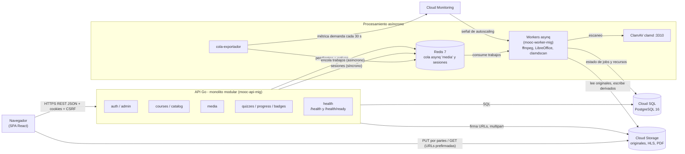
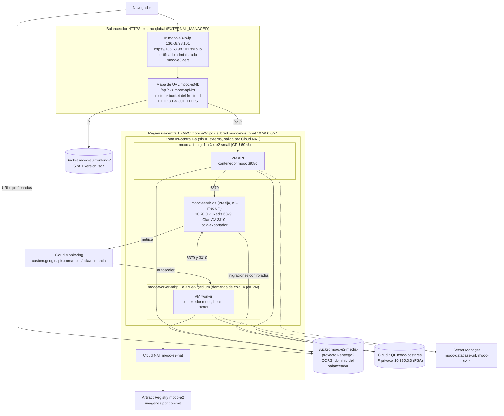

# Arquitectura de la Entrega 3: aplicación elástica IaaS

Este documento describe la solución **efectivamente desplegada** en Google Cloud para la Entrega 3 y sus cambios frente a la Entrega 2. Todo lo que aquí se nombra (recursos, parámetros y tiempos) sale de los scripts de [`deploy/gcp/e3/`](../../deploy/gcp/e3/README.md), de sus registros y de los informes de pruebas.

- Proyecto: `proyecto1-entrega2-desarrollo`. Región `us-central1`, zona `us-central1-a`.
- Frontend y API: https://136.68.98.101.sslip.io (la API bajo `/api/v1`).
- Commit de la API desplegada al escribir este documento: `12569a5`.
- Documentos relacionados:
  - Capa asíncrona en detalle (cola, workers, retiro seguro): [`arquitectura-workers.md`](arquitectura-workers.md).
  - Verificación del frontend: [`matriz-verificacion-frontend.md`](matriz-verificacion-frontend.md).
  - Pruebas de carga: [`../../capacity-planning/pruebas_de_carga_entrega3.md`](../../capacity-planning/pruebas_de_carga_entrega3.md).
  - Integridad entre réplicas: [`../../capacity-planning/integridad-replicas-e3.md`](../../capacity-planning/integridad-replicas-e3.md).
  - Deuda técnica: `deuda-tecnica.md`.
- Fuentes de los diagramas: [`diagramas/componentes.mmd`](diagramas/componentes.mmd) y [`diagramas/despliegue.mmd`](diagramas/despliegue.mmd) (Mermaid; GitHub los muestra también dentro de este documento).

## 1. Cambios frente a la Entrega 2

| Componente | Entrega 2 | Entrega 3 |
| --- | --- | --- |
| API | Una VM fija (`mooc-e2-web`) con Docker Compose | Grupo `mooc-api-mig`, 1 a 3 VM e2-small, autoscaling por CPU |
| Entrada | Caddy con HTTPS en la VM web | Balanceador HTTPS externo global con certificado administrado y health checks |
| Arranque | VM configurada a mano una vez | Imagen de máquina por commit + `mooc.service`; cada VM nueva arranca sola |
| Workers | Una VM fija con worker, Redis y ClamAV | Grupo `mooc-worker-mig`, 1 a 3 VM e2-medium, autoscaling por la demanda de la cola |
| Cola y sesiones | Redis dentro de la VM de workers | Redis en `mooc-servicios`, VM fija fuera de los grupos |
| Secretos | Archivo `.env` en cada VM | Secret Manager, leído al arrancar con la identidad de cada VM |
| Migraciones | Script desde el equipo de desarrollo | Una sola vez desde `mooc-servicios`, con bloqueo de golang-migrate |
| Frontend | No exigido | SPA React publicada en un bucket detrás del mismo balanceador |
| Persistencia | Cloud SQL y Cloud Storage | Las mismas instancias, compartidas por todas las réplicas |

Las VM de la Entrega 2 (`mooc-e2-web` y `mooc-e2-worker`) quedaron apagadas. La cola y las sesiones se migraron con `REPLICAOF` antes de cambiar la API de Redis, sin perder trabajos.

## 2. Modelo de componentes



**Responsabilidades:**
- **Frontend (React 19 + Vite):** recorridos de estudiante y profesor. Habla con la API por REST JSON y sube o reproduce archivos directo contra Cloud Storage con URLs prefirmadas. Muestra estados de carga, vacío, procesamiento, éxito y error.
- **API (Go, Echo, monolito modular):** módulos `auth`, `admin`, `courses`, `catalog`, `media`, `quizzes`, `progress` y `badges` en un solo binario. No guarda estado local: sesiones en Redis, datos en PostgreSQL y archivos en Cloud Storage.
- **Workers (asynq):** escaneo antivirus, transcodificación a HLS y conversión de presentaciones a PDF. Idempotentes: el estado del job en PostgreSQL evita derivados duplicados.
- **Redis 7:** cola asynq `media` y sesiones. AOF activado y `maxmemory-policy noeviction`.
- **ClamAV:** escaneo por red para los workers.
- **`cola-exportador`:** publica cada 30 s la demanda de la cola (pendientes + activos), que es la señal del autoscaling de workers.
- **Cloud SQL (PostgreSQL 16):** fuente de verdad transaccional.
- **Cloud Storage:** originales, derivados HLS, PDF convertidos e imágenes. El frontend compilado vive en otro bucket.

**Comunicaciones:**
- Síncronas:
  - Navegador → balanceador → API (HTTPS).
  - API → PostgreSQL y API → Redis (sesiones).
  - Navegador → Cloud Storage (URLs prefirmadas).
  - Workers → ClamAV.
- Asíncronas:
  - API → cola `media` en Redis → workers. Al confirmar una carga, la API encola el primer trabajo; cada worker encadena los siguientes según el tipo de archivo.
  - El estado visible del recurso (`processing_status`) lo actualiza el worker en PostgreSQL, y el frontend lo consulta.

## 3. Modelo de despliegue



**Red:**
- VPC `mooc-e2-vpc`, subred `mooc-e2-subnet` (10.20.0.0/24) en `us-central1`. Se reutiliza la red de la Entrega 2.
- Ninguna VM tiene IP externa. La salida a Internet (Artifact Registry, Secret Manager, Cloud Storage) va por Cloud NAT (`mooc-e2-router`, `mooc-e2-nat`).
- Cloud SQL solo tiene IP privada (10.235.0.3) por Private Service Access (rango `mooc-e2-private-services`), con cifrado obligatorio (`sslMode: ENCRYPTED_ONLY`).
- `mooc-servicios` tiene la IP interna reservada `mooc-servicios-ip` (10.20.0.7). Las plantillas guardan `REDIS_ADDR=10.20.0.7:6379`, y esa dirección no cambia aunque la VM se recree.

**Reglas de firewall (entrada):**
- `mooc-e3-allow-hc-api`: rangos de Google para health checks y balanceador (130.211.0.0/22 y 35.191.0.0/16) → tcp:8080, solo a la etiqueta `mooc-api`.
- `mooc-e3-allow-hc-worker`: los mismos rangos → tcp:8081, solo a `mooc-worker`. Los workers no reciben ningún otro tráfico.
- `mooc-e3-allow-servicios`: tcp:6379 y tcp:3310, solo desde las etiquetas `mooc-api` y `mooc-worker` hacia `mooc-servicios`.
- `mooc-e3-allow-iap-ssh`: tcp:22 solo desde Identity-Aware Proxy (35.235.240.0/20). La administración se hace con `gcloud compute ssh --tunnel-through-iap`.

**Exposición pública:** solo la IP del balanceador, en los puertos 443 y 80 (este último redirige a HTTPS). `/metrics` y `/health` no se publican; solo `/api/*` llega a la API. PostgreSQL, Redis, ClamAV y los workers no tienen ruta desde Internet.

## 4. Plantillas e inicialización automática

### 4.1 Imagen de máquina y arranque

`02-imagen-maquina.ps1 -Rol api|worker` construye el contenedor con la etiqueta del commit (por ejemplo `mooc-e2-api:12569a5`) y lo sube a Artifact Registry. Después crea una VM temporal, le instala Docker y le descarga ese contenedor, y guarda una imagen de máquina `mooc-<rol>-<commit>` en la familia `mooc-<rol>`. Así toda VM nueva nace con el contenedor ya descargado.

Al encender una VM, `mooc.service` (systemd):
1. Ejecuta `mooc-preparar.sh`, que lee de los metadatos de la plantilla:
   - la imagen del contenedor (`mooc-imagen`);
   - la configuración no sensible (`mooc-config`, ver [`config/api.config`](../../deploy/gcp/e3/config/api.config));
   - los nombres de los secretos (`mooc-secretos`).
2. Pide los secretos a Secret Manager con la cuenta de servicio de la VM y escribe `/run/mooc/env` en tmpfs con permisos 600. No quedan en disco.
3. Borra cualquier contenedor previo y arranca uno con nombre fijo `mooc` (`Restart=always`). Un reinicio de la VM o del servicio no duplica procesos.
4. Al detenerse, `docker stop -t <mooc-detener-s>` da tiempo al apagado ordenado: 40 s en la API y 330 s en los workers.

No hay acceso manual ni pasos posteriores. **Las migraciones no se ejecutan al arrancar** (sección 4.3).

### 4.2 Plantilla de la API

`03-grupo-api.ps1 -Fase Plantilla` crea `mooc-api-<commit>-<fecha>`:
- **Máquina:** e2-small (2 vCPU compartidas, 2 GB), disco de 20 GB pd-balanced.
- **Imagen:** `mooc-api-<commit>`: Debian 12, Docker, contenedor y `mooc.service`.
- **Red:** `mooc-e2-subnet`, sin IP externa, etiqueta `mooc-api`.
- **Identidad:** `sa-mooc-api`.
- **Configuración no sensible:** `PORT=8080`, `REDIS_ADDR`, bucket de medios, cookies `Secure` y `SameSite=Lax`, CSRF activo, `DB_MAX_CONNS=5`, `SHUTDOWN_DRAIN_SECONDS=10` y `SHUTDOWN_TIMEOUT_SECONDS=20`.
- **Verificación:** antes de crear la plantilla, el script comprueba que el bucket de medios exista, para no publicar una configuración rota.

Todas las VM de un grupo usan la misma plantilla, y con ella el mismo commit y la misma configuración. Una versión nueva se publica con `02`, luego `03 -Fase Plantilla` y luego `03 -Fase Actualizar`. Esta última hace una actualización progresiva (`max-surge=1`, `max-unavailable=0`): crea una VM con la versión nueva, espera a que esté sana y retira una vieja.

La plantilla de workers sigue el mismo mecanismo y se describe en [`arquitectura-workers.md`](arquitectura-workers.md#plantilla-de-los-workers): e2-medium, 30 GB, `WORKER_CONCURRENCY=2`, ffmpeg y LibreOffice dentro del contenedor.

### 4.3 Migraciones controladas

`05-migraciones.ps1 -Fase Version|Aplicar` corre **una sola vez** y nunca en el arranque de las réplicas:
1. Empaqueta `migrations/` y las envía a `mooc-servicios` como metadatos temporales, que se borran al final.
2. En esa VM, `migrar.sh` lee `DATABASE_URL` de Secret Manager con `sa-mooc-servicios`.
3. Ejecuta golang-migrate v4.17.1 en un contenedor. golang-migrate toma un bloqueo en PostgreSQL, así que dos ejecuciones simultáneas no aplican la misma migración dos veces.

Las migraciones se aplican antes de publicar una versión de la API que las necesite. La versión actual de la base es la 5, igual que el repositorio.

### 4.4 Tiempo de arranque y criterio de listo

- **API:** está lista cuando `GET /health/ready` responde 200. Para eso la réplica hace ping a PostgreSQL y a Redis con un tiempo límite de 1,5 s y no se está apagando. Tiempo medido desde la creación de la VM hasta que arranca el contenedor: **25 a 28 s** (`03-grupo-api.ps1 -Fase Probar`, 12/10 y 16/10). El balanceador la incorpora tras 2 aciertos seguidos del health check, unos 10 s más.
- **Workers:** están listos cuando `GET :8081/health` responde 200 y el log dice `escuchando en la cola 'media'`. Tiempo medido: **48 s**. La imagen es más grande por ffmpeg y LibreOffice.

### 4.5 Frontend

- **Ubicación:** bucket `mooc-e3-frontend-<proyecto>` (backend bucket `mooc-e3-frontend-bb`). `index.html` funciona como página principal y como página de error, para que las rutas de la SPA se resuelvan en el navegador.
- **Versión identificable:** `08-balanceador.ps1 -Fase Publicar` compila `frontend/` con el commit actual y publica `/version.json`.
- **Conexión con la API:** mismo dominio, ruta `/api/v1`. Las cookies `mooc_session` (HttpOnly, Secure, SameSite=Lax) y `mooc_csrf` funcionan sin CORS, y el frontend envía el encabezado `X-CSRF-Token` en las escrituras.
- **CORS:** solo en el bucket de medios, porque el navegador sube los archivos directo a Cloud Storage. Orígenes permitidos: `https://136.68.98.101.sslip.io` y `http://localhost:5173` (desarrollo). Métodos PUT, GET y HEAD (`06-cors-bucket.ps1`).

## 5. Políticas de escalamiento

### 5.1 API (`mooc-api-mig`)

- **Señal:** utilización de CPU promedio del grupo. La API no tiene estado y atiende cada solicitud en línea, así que su trabajo crece con el volumen de solicitudes y se refleja en la CPU. En el Escenario 1 de la E2, la CPU de la VM web subió de valores de un dígito a un 35-40 % al aumentar la carga. Es la señal nativa del autoscaler y no necesita métricas propias.
- **Objetivo:** 60 % de CPU (`--target-cpu-utilization=0.6`). Deja margen para absorber picos mientras arranca una réplica nueva sin llegar a saturar las e2-small, que tienen CPU compartida con ráfagas.
- **Inicialización:** 120 s (`--cool-down-period=120`). Medido: 25 a 28 s hasta el contenedor, más la incorporación al balanceador. El margen evita decidir con métricas de una VM que todavía está arrancando.
- **Estabilización y reducción:** Compute Engine espera 10 minutos de recomendaciones estables antes de reducir y, además, `scale-in-control` permite como máximo 1 VM retirada cada 600 s. Así se evitan oscilaciones cuando la carga baja por un momento.
- **Límites:** mínimo 1, máximo 3. Al llegar a 3, el autoscaler reporta `CAPPED_AT_MAX_NUM_REPLICAS`, la latencia sube y las solicitudes siguen entrando por el balanceador; no se rechazan por el autoscaler.
- **Autorreparación:** health check `mooc-api-hc-vida` (`GET /health`), con 180 s de retraso inicial. Es distinto del de tráfico (sección 6).

### 5.2 Workers (`mooc-worker-mig`)

Resumen (detalle y justificación en [`arquitectura-workers.md`](arquitectura-workers.md#política-de-escalamiento)):
- **Señal:** métrica `custom.googleapis.com/mooc/cola/demanda` = pendientes + activos de la cola `media`. La CPU no sirve: ffmpeg satura la CPU con un solo trabajo. Los activos se suman porque una cola sin pendientes puede tener trabajos en ejecución.
- **Objetivo:** 4 trabajos por VM (`singleInstanceAssignment: 4`): con concurrencia 2, son 2 en ejecución y 2 en espera por VM.
- **Inicialización:** 120 s. Medido: 48 s hasta procesar.
- **Estabilización y reducción:** los mismos 10 minutos de espera y como máximo 1 VM retirada cada 600 s.
- **Límites:** mínimo 1, máximo 3. Al llegar a 3, los trabajos esperan en la cola; no se rechazan.
- **Concurrencia total efectiva:** de 2 a 6 trabajos simultáneos.

### 5.3 Ciclos observados

- **Workers:**
  - Verificación del 22/10, con demanda simulada: del aumento de la demanda a la decisión de escalar, 1 min 57 s; de la decisión a la VM procesando, 48 s; primera reducción 11 min después de bajar la demanda.
  - Escenario 3B del 28/10, con carga real: subió a 3 workers, drenó la cola, completó un retiro controlado con trabajos activos y volvió a 1 ([informe, sección 7](../../capacity-planning/pruebas_de_carga_entrega3.md)).
- **API:** el ciclo de escalamiento (Escenario 3A) se documenta en el informe de capacidad, sección 6. *Pendiente de incorporar los resultados.*

## 6. Balanceador y verificaciones de salud

Configuración (`08-balanceador.ps1 -Fase Crear`):
- **Dirección:** IP global reservada `mooc-e3-lb-ip` (136.68.98.101). Dominio `136.68.98.101.sslip.io`.
- **Certificado:** administrado por Google (`mooc-e3-cert`) para ese dominio.
- **Listeners:** reglas de reenvío `mooc-e3-https` (443, proxy `mooc-e3-https-proxy`) y `mooc-e3-http` (80, proxy `mooc-e3-http-proxy` con el mapa `mooc-e3-lb-redirect`, que responde 301 a HTTPS).
- **Mapa de URL `mooc-e3-lb`:** `/api/*` va al servicio de backend `mooc-api-bs`; el resto va al backend bucket del frontend.
- **Servicio de backend `mooc-api-bs`:**
  - Esquema `EXTERNAL_MANAGED` y protocolo HTTP hacia las VM, puerto con nombre `http` (8080). El HTTPS termina en el balanceador.
  - Backend `mooc-api-mig`, modo `UTILIZATION` con `max-utilization=0.8`.
  - Tiempo límite de 30 s.
  - Drenaje de conexiones de 30 s.
  - Logs del balanceador al 100 %.
- **Política de distribución:** la predeterminada del balanceador, que reparte entre las instancias sanas del grupo sin afinidad de sesión. No hace falta afinidad porque las sesiones viven en Redis. Cada respuesta incluye el encabezado `X-Instance-Id`, que permite ver qué réplica atendió (`-Fase Probar` cuenta el reparto en una ráfaga).

**Health checks: dos, con funciones distintas:**
- **`mooc-api-hc-listo` (tráfico):** decide a qué réplicas manda solicitudes el balanceador.
  - `GET /health/ready`, puerto 8080.
  - Intervalo 5 s, timeout 3 s.
  - 2 aciertos para pasar a sana y 2 fallos para salir.
  - Responde 503 si PostgreSQL o Redis no responden, o si la réplica se está apagando.
- **`mooc-api-hc-vida` (autorreparación):** decide cuándo el grupo recrea una VM.
  - `GET /health`, puerto 8080.
  - Intervalo 10 s, timeout 5 s.
  - 2 aciertos y 3 fallos.
  - Solo comprueba que el proceso responde.
- **Por qué son dos:** si Redis o PostgreSQL fallan un momento, la réplica sale del balanceador (exclusión), pero el grupo no la destruye (reparación). Si el proceso se cuelga, el grupo la reemplaza.
- **Qué exponen:** ninguno de los dos devuelve direcciones, credenciales ni mensajes de error; solo `ok`, `fail`, `ready` o `draining`. La fase `Excluir` de `08-balanceador.ps1` lo demuestra: bloquea Redis en una instancia, `/health/ready` pasa a 503, el balanceador deja de enviarle tráfico mientras la autorreparación no la recrea, y luego la reincorpora.

**Solicitudes en curso al retirar una instancia de la API:**
1. Al recibir SIGTERM (por reducción, actualización o reparación), la API pone `/health/ready` en 503 (`draining`) y sigue atendiendo durante `SHUTDOWN_DRAIN_SECONDS=10`. En ese tiempo el balanceador deja de mandarle solicitudes nuevas.
2. Luego cierra el servidor y espera hasta `SHUTDOWN_TIMEOUT_SECONDS=20` a que terminen las solicitudes en curso.
3. El balanceador además drena las conexiones durante 30 s, y `docker stop` le da 40 s en total al contenedor.

## 7. Persistencia y estado compartido

- **Sesiones:** en Redis, compartidas por todas las réplicas. Una solicitud puede llegar a cualquier instancia sin perder la sesión. Esto se verificó alternando réplicas (I1 a I3 en [`integridad-replicas-e3.md`](../../capacity-planning/integridad-replicas-e3.md)).
- **Datos de negocio:** solo en Cloud SQL, compartida por API, workers y migraciones.
- **Archivos:** solo en Cloud Storage. Los workers usan `/tmp/media` para archivos temporales que se pueden reconstruir desde el bucket y se pierden con la VM. Ninguna copia local es la única fuente de un dato.
- **Cachés locales:** la API no tiene. No hay estado en memoria que deba sincronizarse entre réplicas.
- **Idempotencia:**
  - El envío definitivo de un intento de quiz se protege con `Idempotency-Key` e índices únicos.
  - Los trabajos multimedia usan una clave de idempotencia por `asset:tipo` y su estado en PostgreSQL.
  - Se verificó el envío duplicado entre réplicas sin doble calificación (I3).
- **Conexiones a PostgreSQL:** `DB_MAX_CONNS=5` por instancia. Con 3 API y 3 workers son como máximo 30 conexiones de la aplicación, por debajo de las 50 de `db-g1-small`, que deja margen para migraciones y administración ([`cloud-sql-pool-e3.md`](../../capacity-planning/cloud-sql-pool-e3.md)).

## 8. Seguridad e identidades

**Autorización ante Google Cloud (IAM): una cuenta de servicio por rol, con permisos mínimos:**
- **`sa-mooc-api`:**
  - `roles/logging.logWriter` y `roles/monitoring.metricWriter` en el proyecto.
  - `roles/artifactregistry.reader` solo en el repositorio `mooc-e2`.
  - `roles/secretmanager.secretAccessor` solo en `mooc-database-url`, `mooc-s3-access-key` y `mooc-s3-secret-key`.
- **`sa-mooc-worker`:** los mismos permisos que `sa-mooc-api`.
- **`sa-mooc-servicios`:**
  - `logging.logWriter` y `monitoring.metricWriter`.
  - `artifactregistry.reader` en `mooc-e2`, para el exportador.
  - `secretmanager.secretAccessor` solo en `mooc-database-url`, para las migraciones y el script de cuentas.
- **Personas del equipo:** acceden con sus cuentas de Google y `roles/iap.tunnelResourceAccessor` para SSH por IAP.

**Autenticación de la aplicación ante PostgreSQL (aparte de IAM):**
- La API, los workers y las migraciones se conectan con el usuario y la contraseña de base de datos incluidos en `DATABASE_URL`, por la IP privada y con cifrado obligatorio.
- Esa URL vive solo en Secret Manager. IAM decide qué VM puede *leer* el secreto; PostgreSQL decide qué puede *hacer* ese usuario.

**Cloud Storage:**
- La aplicación usa llaves HMAC (`S3_ACCESS_KEY` y `S3_SECRET_KEY`), guardadas también en Secret Manager, para firmar las URLs.
- El navegador nunca recibe llaves, solo URLs prefirmadas con vencimiento: 1 h para subir partes y 15 min para descargar.

**Secretos:**
- No están en el código, las imágenes, las plantillas, los scripts ni las evidencias. Las plantillas solo llevan los *nombres* de los secretos.
- Los ejemplos de configuración (`config/api.config` y `config/worker.config`) no tienen valores sensibles.
- Las evidencias de k6 se publican con los tokens de sesión y las firmas de URLs reemplazados por `<redactado>`.

**Aplicación:**
- Cookies `Secure`, `HttpOnly` y `SameSite=Lax`, protección CSRF y autorización por rol, propiedad e inscripción en el servidor.
- `/courses/:id/preview` solo entrega el borrador al profesor dueño o a un administrador; un estudiante inscrito solo ve la versión publicada.

## 9. Operación y recuperación

### 9.1 Despliegue desde cero

En este orden, desde la raíz del repositorio (Windows PowerShell o Cloud Shell con `pwsh`). Cada fase es idempotente y deja su registro en `deploy/gcp/logs/`:
1. **Red y base de la E2** (VPC, subred, NAT, Cloud SQL con IP privada, bucket de medios): scripts `deploy/gcp/01-*` y `06-correcciones-entrega2.ps1` (ver [`docs/entrega2`](../entrega2/arquitectura_entrega2.md)).
2. **Identidades y secretos:** `01-secretos-identidades.ps1`.
3. **VM de servicios:** `04-vm-servicios.ps1 -Fase Identidad`, luego `Red` y luego `Crear`.
4. **Migraciones:** `05-migraciones.ps1 -Fase Aplicar`.
5. **API:**
   - `02-imagen-maquina.ps1 -Rol api`.
   - `03-grupo-api.ps1`, con las fases `Red`, `Plantilla -RedisAddr 10.20.0.7:6379`, `Salud`, `Grupo` y `Autoscaling`.
6. **Workers:**
   - `02-imagen-maquina.ps1 -Rol worker`.
   - `07-grupo-workers.ps1`, con las fases `Red`, `Salud`, `Exportador`, `Plantilla`, `Grupo` y `Autoscaling`.
7. **Balanceador y frontend:** `08-balanceador.ps1 -Fase Crear` y luego `-Fase Publicar`. El certificado tarda de 15 a 60 minutos en quedar `ACTIVE`.
8. **CORS del bucket de medios:** `06-cors-bucket.ps1 -Origen "https://<dominio>"`.
9. **Cuenta de administrador:** `09-cuenta-admin.ps1 -Fase Clave -Correo <correo>`. La clave se entrega por un medio privado.

### 9.2 Verificación

- `03-grupo-api.ps1 -Fase Probar`: por instancia, `/health/ready`, `X-Instance-Id`, versión del contenedor y tiempo de arranque.
- `07-grupo-workers.ps1 -Fase Probar`: health de cada worker, consumo de la cola y muestras del exportador.
- `08-balanceador.ps1 -Fase Probar`: certificado, salud por instancia, rutas (SPA, API, `version.json`, redirección) y reparto entre réplicas.
- `08-balanceador.ps1 -Fase Sesion`: login, `/me` entre réplicas, CSRF (403 sin encabezado) y logout.
- `05-migraciones.ps1 -Fase Version`: versión de la base frente al repositorio.

### 9.3 Encender y apagar (control de costos)

Encender, en este orden:
```powershell
gcloud sql instances patch mooc-postgres --activation-policy=ALWAYS     # 3 a 5 min
.\deploy\gcp\e3\04-vm-servicios.ps1 -Fase Encender
.\deploy\gcp\e3\03-grupo-api.ps1 -Fase Encender
.\deploy\gcp\e3\07-grupo-workers.ps1 -Fase Encender
```

Apagar, en orden inverso:
```powershell
.\deploy\gcp\e3\07-grupo-workers.ps1 -Fase Apagar
.\deploy\gcp\e3\03-grupo-api.ps1 -Fase Apagar
.\deploy\gcp\e3\04-vm-servicios.ps1 -Fase Apagar
gcloud sql instances patch mooc-postgres --activation-policy=NEVER
```

Los grupos se apagan con el autoscaling en `off` y 0 instancias. No se apagan `mooc-servicios` ni Cloud SQL con los grupos encendidos: sin ellos los workers no arrancan y la API no puede iniciar sesión. El balanceador queda creado, pero sin backends sanos responde 503 en `/api/*`.

### 9.4 Retiro de recursos

Después de conservar las evidencias:
- `08-balanceador.ps1 -Fase Borrar -Confirmar` quita reglas de reenvío, proxies, mapas, certificado y servicios de backend. Conserva la IP y los buckets.
- Los grupos, las plantillas, las imágenes viejas (`gcloud compute images list --filter="family~^mooc-"`) y las VM de la E2 se borran con `gcloud compute ... delete`.
- Cloud SQL se deja detenida (`NEVER`) o se borra después de exportar un respaldo.
- La reconstrucción para una sustentación síncrona es la sección 9.1.

### 9.5 Configuración y secretos

- La configuración no sensible está versionada en `deploy/gcp/e3/config/*.config` y se copia al metadato `mooc-config` de cada plantilla.
- Un cambio de configuración se publica con una plantilla nueva y `-Fase Actualizar`.
- Para cambiar un secreto se agrega una versión en Secret Manager (`01-secretos-identidades.ps1 -ActualizarValores` o `gcloud secrets versions add`). Las VM la leen en su siguiente arranque, así que basta con `-Fase Actualizar` para reemplazarlas.

## 10. Capacidad, costo y limitaciones

### 10.1 Configuración efectiva

- **API:** 1 a 3 × e2-small (2 vCPU compartidas, 2 GB), 20 GB pd-balanced.
- **Workers:** 1 a 3 × e2-medium (2 vCPU compartidas, 4 GB), 30 GB pd-balanced, concurrencia 2 por VM (2 a 6 en total).
- **Servicios:** 1 × e2-medium, 20 GB pd-balanced: Redis 7, ClamAV y `cola-exportador`.
- **Base de datos:** Cloud SQL PostgreSQL 16, `db-g1-small` (1 vCPU compartida, 1,7 GB), 10 GB SSD, una zona, sin alta disponibilidad, `max_connections=50`.
- **Objetos:** Cloud Storage Standard en `us-central1` (bucket de medios y bucket del frontend).
- **Entrada:** balanceador HTTPS externo global con 2 reglas de reenvío (443 y 80).

### 10.2 Costo estimado

**Supuestos:**
- Precios de lista en USD de `us-central1`, consultados el 29/10/2026 ([e2-small](https://gcloud-compute.com/e2-small.html), [e2-medium](https://gcloud-compute.com/e2-medium.html), [Cloud Load Balancing](https://cloud.google.com/load-balancing/pricing), [Cloud NAT](https://cloud.google.com/nat/pricing), [Cloud SQL `db-g1-small`](https://www.bytebase.com/dbcost/cloudsql/instance/db-g1-small.md)).
- Mes de 730 horas con todo encendido, sin descuentos por uso sostenido.
- Tráfico de pruebas bajo: menos de 10 GB procesados por el balanceador y por NAT.
- Para estimaciones formales conviene recalcular con la [calculadora de Google Cloud](https://cloud.google.com/products/calculator).

| Componente | Precio unitario | 1 API + 1 worker | 3 API + 3 workers |
| --- | --- | ---: | ---: |
| VM API e2-small | 0,0168 USD/h | 12,26 | 36,79 |
| VM workers e2-medium | 0,0335 USD/h | 24,46 | 73,37 |
| VM `mooc-servicios` e2-medium | 0,0335 USD/h | 24,46 | 24,46 |
| Discos pd-balanced (aprox. 0,10 USD/GB-mes) | 20 GB API, 30 GB worker, 20 GB servicios | 7,00 | 17,00 |
| Cloud SQL `db-g1-small` + 10 GB SSD | aprox. 0,035 USD/h + almacenamiento | 27,25 | 27,25 |
| Balanceador: reglas de reenvío | 0,025 USD/h (primeras 5) | 18,25 | 18,25 |
| Balanceador: datos procesados | 0,008 USD/GiB | < 0,10 | < 0,10 |
| Cloud NAT (gateway por VM + 1 IP) | 0,0014 USD/h por VM + 0,005 USD/h | 6,72 | 10,81 |
| Cloud Storage, Artifact Registry, imágenes de máquina, Secret Manager, Logging y Monitoring | Volumen bajo | < 5 | < 5 |
| **Total aproximado por mes (24/7)** | | **≈ 125** | **≈ 213** |
| **Total aproximado por hora** | | **≈ 0,17** | **≈ 0,29** |

**Cómo leer la tabla:**
- El costo fijo (balanceador, VM de servicios y Cloud SQL) es aproximadamente 70 USD al mes aunque no haya carga. Es el costo adicional principal frente a la Entrega 2, que no tenía balanceador ni VM de servicios aparte.
- Cada réplica adicional de la API cuesta unos 0,019 USD/h y cada worker unos 0,038 USD/h. Esto incluye su parte de disco y NAT.
- Como el entorno se apaga cuando no se usa (sección 9.3), el gasto real depende de las horas de prueba, no del mes completo.

### 10.3 Consumo observado

Fuente: **Facturación → Informes** del proyecto `proyecto1-entrega2-desarrollo`, agrupado por servicio, período de cargo del 12/10/2026 (inicio de la E3) al 29/10/2026, consultado el 29/10/2026 ([captura](evidencias-costos/facturacion-servicios-12-29oct.jpg)). Valores en USD.

| Servicio | Costo por uso | Créditos | Neto |
| --- | ---: | ---: | ---: |
| Compute Engine (VM de los grupos, `mooc-servicios`, discos e imágenes) | 7,38 | −7,38 | 0,00 |
| Cloud SQL | 2,82 | −2,82 | 0,00 |
| Networking (balanceador, Cloud NAT, IP) | 1,78 | −1,78 | 0,00 |
| VM Manager | 0,07 | −0,07 | 0,00 |
| Otros (Cloud Storage, Artifact Registry, Secret Manager, Monitoring) | < 0,01 | | 0,00 |
| **Total** | **≈ 12,05** | **−12,05** | **0,00** |

Para comparar, todo octubre (incluida la operación de la E2 del 1 al 11 de octubre) suma 30,57 USD de costo por uso: Compute Engine 17,94, Cloud SQL 8,29, Networking 3,48 y VM Manager 0,86. El costo lo cubren por completo los créditos de la cuenta educativa.

**Contraste con la estimación de 10.2:** 12 USD en 18 días equivalen a unas 70 horas de la configuración mínima (≈ 0,17 USD/h). El gasto real es mucho menor que el de un mes 24/7 (≈ 125 USD) porque el entorno se encendió solo para desplegar y probar, y se apagó con los scripts de la sección 9.3. La facturación de Google Cloud se consolida con hasta un día de retraso, así que las corridas del 28/10 pueden no estar completas en esta consulta.

### 10.4 Relación con los resultados de las pruebas

- **Escenario 2 y 3B** ([informe](../../capacity-planning/pruebas_de_carga_entrega3.md)):
  - Con el grupo de workers, la cola llegó a 6 trabajos activos simultáneos (3 VM × 2) y drenó sola al terminar la carga.
  - El tiempo `upload → ready` p95 fue de 33,6 s en baseline, 68,1 s en L1, 143,9 s en L2 y 100,0 s en L3. La acumulación inicial en la cola se explica por los 2 min que tarda el autoscaler en decidir más los 48 s de arranque, antes de que la capacidad adicional procese.
  - Errores HTTP de 0 % a 0,18 %.
  - Lo que limita ahora el tiempo hasta disponibilidad es la transcodificación en CPU compartida y la reacción del autoscaler, no la API.
- **Retiro seguro:** se retiró un worker con 3 trabajos activos; la cola terminó en `pendientes=0`, `activos=0` y `reintentos=0`, sin trabajos duplicados.
- **Integridad entre réplicas** ([`integridad-replicas-e3.md`](../../capacity-planning/integridad-replicas-e3.md)):
  - I1: sesión válida al alternar réplicas.
  - I2: escritura en una réplica y lectura desde otra.
  - I3: doble envío de quiz sin doble calificación.
  - I4: acceso a recursos desde distintas réplicas.
  - I5: datos conservados al retirar una réplica de la API.

  El retiro de un worker con trabajos activos se verificó en el Escenario 3B.
- **Escenario 1 y 3A:** *pendiente de incorporar los resultados* (latencias, réplicas activas y su relación con la CPU y con PostgreSQL).

### 10.5 Puntos únicos de falla y limitaciones

- **`mooc-servicios`:** aloja Redis (cola y sesiones), ClamAV y el exportador. Si cae, la API pierde las sesiones y la cola, y los workers no arrancan. La IP fija y el AOF permiten recrearla sin perder la cola persistida en disco. Alternativa futura: Memorystore para Redis.
- **Cloud SQL `db-g1-small` sin alta disponibilidad:** una sola zona y CPU compartida. Si cae, la API responde 503 en `/health/ready` y sale del balanceador. Con 3 API y 3 workers se usan hasta 30 de las 50 conexiones.
- **`cola-exportador`:** si deja de publicar, el autoscaler de workers conserva el tamaño actual (no sube ni baja), pero los workers siguen procesando.
- **Una sola zona (`us-central1-a`):** el enunciado no exige alta disponibilidad multizonal. Un grupo regional la daría sin cambiar la aplicación.
- **Redis sin contraseña:** el acceso está limitado por firewall a las etiquetas de la API y los workers.
- **Dominio `sslip.io`:** depende de un servicio DNS público y gratuito. Para producción se usaría un dominio propio.
- **Reacción del autoscaling:** entre el aumento de la demanda y la capacidad nueva pasan unos 2,5 a 3 minutos. Las ráfagas muy cortas se absorben con la cola (workers) o con mayor latencia (API), no con réplicas nuevas.

## 11. Alternativas evaluadas

- **Docker Swarm o Kubernetes como orquestador:**
  - Cada VM corre un único contenedor de su rol. El grupo de instancias decide cuántas VM hay, el balanceador decide a cuál enviar tráfico y systemd mantiene vivo el contenedor dentro de cada VM.
  - Un orquestador agregaría un plano de control (manager de Swarm o *control plane* de Kubernetes) que sería otro punto de falla, sin ahorrar recursos, porque no hay varios contenedores que acomodar por máquina.
  - Swarm no crea máquinas ni tiene autoscaling propio. El enunciado exige escalar máquinas, no procesos dentro de una máquina, y no exige migrar a Kubernetes.
  - Sería una evolución razonable si en una entrega futura se adoptan contenedores administrados o varios servicios pequeños por máquina.
- **CPU como señal de los workers:** se descartó porque ffmpeg satura la CPU con un solo trabajo y la señal no distingue entre 1 y 20 trabajos en espera. Se usa la demanda de la cola.
- **Redis dentro del grupo de workers:** no es admisible, porque la cola desaparecería con la VM que el autoscaling retire. Por eso vive en `mooc-servicios`.
- **Migraciones en el arranque de cada réplica:** se descartó porque varias réplicas las intentarían al mismo tiempo. Corren una sola vez desde `mooc-servicios`.
- **Afinidad de sesión en el balanceador:** innecesaria, porque las sesiones están en Redis. Usarla ocultaría errores de estado local.
