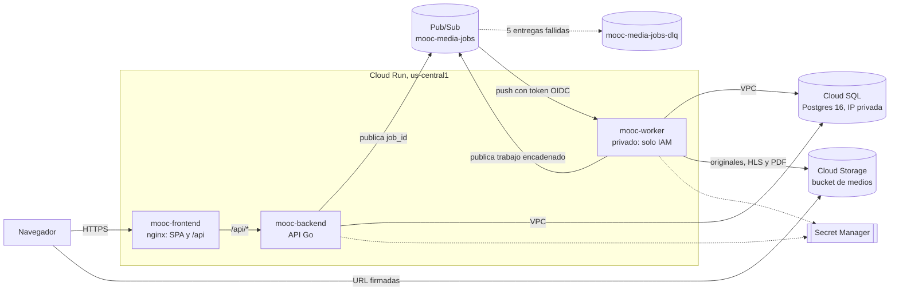

# Arquitectura de la Entrega 4

La plataforma corre en tres servicios de Cloud Run (frontend, backend y workers) en el proyecto de GCP de Camila, región `us-central1`. Toda la infraestructura la crea Terraform (`infra/terraform/`). Los valores de este documento salen de ese código; si cambian allá, se actualizan aquí.

## Diagrama

## Flujo de una tarea

1. El navegador sube el archivo directo a Cloud Storage con una URL firmada que entrega el backend.
2. Al confirmar la carga, el backend crea el `media_job` en Postgres, publica `{"job_id": "..."}` en `mooc-media-jobs` y responde sin esperar el procesamiento.
3. Pub/Sub entrega el mensaje al worker por push (`POST /pubsub/push`) con un token OIDC de `sa-pubsub-push`.
4. El worker relee el job en Postgres, lo procesa, guarda el resultado y responde 204. Si hace falta otro paso (escaneo → HLS o PDF), publica el siguiente trabajo.
5. Si un mensaje no se confirma, Pub/Sub lo reintenta con espera creciente (10 s a 600 s). Tras 5 entregas pasa a `mooc-media-jobs-dlq`.

Contrato del mensaje y reglas de respuesta: [`contrato-mensaje.md`](contrato-mensaje.md).

## Configuración de cada servicio

**mooc-frontend** (nginx: sirve la SPA y reenvía `/api/*` al backend)

- Región: us-central1
- Instancias: mínimo 0, máximo 3
- CPU y memoria: 1 vCPU, 512 MiB
- Concurrencia: 80 solicitudes por instancia
- Tiempo máximo de solicitud: 60 s
- Acceso: público (`allUsers` con `roles/run.invoker`)
- Cuenta de servicio: `sa-frontend`

**mooc-backend** (API Go)

- Región: us-central1
- Instancias: mínimo 0, máximo 3
- CPU y memoria: 1 vCPU, 1 GiB, con aceleración de CPU al arrancar
- Concurrencia: 40 solicitudes por instancia
- Tiempo máximo de solicitud: 60 s
- Acceso: público; la aplicación autentica a las personas con su sesión
- Red: salida directa a la VPC `mooc-e4-vpc` (solo rangos privados) para llegar a Cloud SQL
- Sonda de arranque: `GET /health/ready` (Postgres)
- Cuenta de servicio: `sa-backend`

**mooc-worker** (procesamiento de medios: ClamAV, ffmpeg, LibreOffice)

- Región: us-central1
- Instancias: mínimo 0, máximo 3
- CPU y memoria: 2 vCPU, 4 GiB, con aceleración de CPU al arrancar
- Concurrencia: 1 tarea por instancia
- Tiempo máximo de solicitud: 600 s, igual al plazo de confirmación de la suscripción
- Acceso: privado; sin `allUsers`, solo `sa-pubsub-push` puede invocarlo y cualquier otra llamada recibe 403
- Red: salida directa a la VPC (solo rangos privados)
- Cuenta de servicio: `sa-worker`

**mooc-migraciones** (Cloud Run Job)

- Región: us-central1
- 1 tarea, sin reintentos
- CPU y memoria: 1 vCPU, 512 MiB
- Tiempo máximo: 600 s
- Red: salida directa a la VPC
- Cuenta de servicio: `sa-migraciones`

En Cloud Run, mínimo 0 instancias significa que un servicio sin tráfico no cobra CPU ni memoria; el costo es el arranque en frío de la primera solicitud.

## Cuentas de servicio y permisos

Invocar un servicio y leer sus datos son permisos distintos, y van en cuentas distintas.

- **sa-frontend**: escribir registros y métricas. No toca datos.
- **sa-backend**: escribir registros y métricas; publicar en `mooc-media-jobs`; leer `mooc-database-url`, `mooc-s3-access-key`, `mooc-s3-secret-key` y `mooc-admin-password`.
- **sa-worker**: escribir registros y métricas; publicar en `mooc-media-jobs` (trabajos encadenados); leer `mooc-database-url`, `mooc-s3-access-key` y `mooc-s3-secret-key`.
- **sa-pubsub-push**: invocar `mooc-worker` (`roles/run.invoker`) y nada más. Es la identidad del token OIDC del push.
- **sa-migraciones**: escribir registros y métricas; leer `mooc-database-url`.
- **sa-medios**: leer y escribir objetos del bucket de medios. Es la dueña de la llave HMAC con la que backend y worker firman URL y usan el bucket.
- **Agente de Pub/Sub** (cuenta administrada por Google): firmar el token OIDC en nombre de `sa-pubsub-push`, publicar en el tópico de fallidos y confirmar en la suscripción del worker.
- **Grupo** (variable `equipo`): ver el proyecto, los registros y las métricas, y publicar imágenes. No modifica infraestructura.

## Secretos

Terraform crea solo los contenedores; `deploy/gcp/e4/01-secretos.ps1` genera y carga los valores sin mostrarlos. Ningún secreto queda en el repositorio, en las imágenes ni en el estado de Terraform.

- `mooc-database-url`: usuario `mooc` con clave aleatoria y la IP privada de Cloud SQL.
- `mooc-s3-access-key` y `mooc-s3-secret-key`: llave HMAC de `sa-medios`.
- `mooc-admin-password`: clave de la primera cuenta de administrador. El backend la crea al arrancar solo si la base no tiene ningún administrador.

## Base de datos y almacenamiento

- Cloud SQL `mooc-e4-postgres`: Postgres 16, `db-g1-small`, solo IP privada por acceso privado a servicios, copia diaria con recuperación a un punto en el tiempo, protegida contra borrado. `max_connections = 50`, suficiente para 3 backends × 5 conexiones, 3 workers × 3 y el job de migraciones.
- Bucket `mooc-e4-medios-<proyecto>`: acceso uniforme, sin acceso público, borrado recuperable de 7 días y CORS con la URL del frontend.
- Artifact Registry `mooc-e4`: imágenes etiquetadas con el commit; Cloud Run las despliega por digest. Conserva las 10 versiones más recientes de cada imagen.
