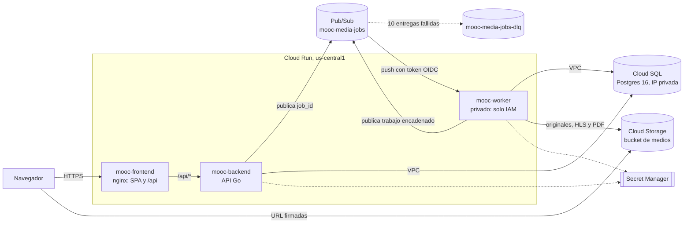

# Informe de arquitectura · Entrega 4: Cloud Run y Pub/Sub

Equipo: Daniela Solarte, Mateo, Samara y Camila · ISIS4426 · Noviembre de 2026

Este informe describe la arquitectura con la que la plataforma MOOC corre en la Entrega 4: tres servicios de Cloud Run (frontend, backend y workers) comunicados por Cloud Pub/Sub y creados por completo con Terraform. Los valores de configuración salen del código de `infra/terraform/`; los resultados de las pruebas, de los archivos de `k6/results/e4/` y de `docs/entrega4/evidencias/`.

Documentos relacionados:

- Diagrama y ficha de cada servicio: [`arquitectura.md`](arquitectura.md)
- Contrato del mensaje y reglas de respuesta del worker: [`contrato-mensaje.md`](contrato-mensaje.md)
- Guía de despliegue reproducible: [`despliegue.md`](despliegue.md)
- Evidencias: [`evidencias.md`](evidencias.md)
- Verificación del escalamiento: [`escalamiento.md`](escalamiento.md)

## 1. Cambios frente a la Entrega 3

En la E3 la aplicación corría en grupos de instancias administrados (máquinas virtuales con plantillas, imagen y arranque propios) detrás de un balanceador, y las tareas multimedia viajaban por una cola de asynq sobre Redis. En la E4 la misma base de código pasa a contenedores administrados por Cloud Run.

- **Cómputo:** de máquinas virtuales que creábamos, parchábamos y escalábamos con políticas propias, a tres servicios de Cloud Run que escalan por solicitudes con un máximo de 3 instancias cada uno.
- **Mensajería:** de asynq sobre Redis a un tópico de Pub/Sub con una suscripción push autenticada hacia el worker.
- **Sesiones:** de Redis a Postgres. Al quitar Redis, ningún componente guarda estado fuera de Cloud SQL y Cloud Storage.
- **Frontend:** de archivos estáticos servidos junto a la API a un servicio propio (nginx) que sirve la SPA y reenvía `/api/*` al backend.
- **Antivirus:** `clamd` pasa a correr dentro de la imagen del worker.
- **Infraestructura:** todo se crea con Terraform: red, Cloud SQL, bucket, Artifact Registry, Pub/Sub, cuentas de servicio, permisos, secretos (solo los contenedores) y servicios. Nada se crea a mano en la consola.
- **Proyecto:** la E4 corre en un proyecto nuevo de GCP, porque el de la E2 y la E3 quedó sin facturación al agotarse el crédito educativo. Terraform permitió recrear todo desde cero.

## 2. Modelo de componentes

Responsabilidad de cada componente:

- **mooc-frontend (nginx):** sirve la aplicación web y reenvía las rutas `/api/*` al backend. Como el navegador ve un solo origen, la API no necesita CORS. No toca datos.
- **mooc-backend (API Go):** expone la API, autentica con sesiones guardadas en Postgres, entrega URL firmadas para subir y descargar archivos, crea los trabajos multimedia y los publica en Pub/Sub sin esperar su ejecución.
- **mooc-worker (Go con ClamAV, ffmpeg y LibreOffice):** recibe cada mensaje por push, ejecuta el trabajo (antivirus, conversión a HLS o conversión de presentaciones a PDF), guarda el resultado y el estado, y publica el siguiente paso cuando hay uno.
- **mooc-migraciones (Cloud Run Job):** aplica las migraciones de la base antes de encender el backend.
- **Pub/Sub:** tópico `mooc-media-jobs`, suscripción push `mooc-media-jobs-worker` y tópico de fallidos `mooc-media-jobs-dlq` con una suscripción de revisión.
- **Cloud SQL (Postgres 16):** fuente de verdad de usuarios, sesiones, cursos, recursos y trabajos multimedia.
- **Cloud Storage:** archivos originales y derivados (HLS y PDF).
- **Secret Manager:** URL de la base, llave HMAC del bucket y clave del primer administrador.
- **Artifact Registry (`mooc-e4`):** imágenes etiquetadas con el commit.

## 3. Modelo de despliegue

- **Proyecto y región:** un proyecto de GCP, región `us-central1` para todos los recursos.
- **Red:** VPC `mooc-e4-vpc`. Cloud SQL solo tiene IP privada, por acceso privado a servicios. Backend, worker y el job de migraciones salen a la VPC por salida directa, solo para rangos privados (`PRIVATE_RANGES_ONLY`). El resto del tráfico (Pub/Sub, Cloud Storage) va directo a las API de Google.
- **Entrada:** frontend y backend tienen URL públicas de Cloud Run con HTTPS. El worker también tiene URL, pero solo acepta llamadas autenticadas de `sa-pubsub-push`.
- **Imágenes:** se construyen con `deploy/gcp/e4/construir-imagenes.ps1`, se etiquetan con el commit y Cloud Run las despliega por digest. Artifact Registry conserva las 10 versiones más recientes de cada imagen.
- **Estado de Terraform:** en un bucket propio, creado por `deploy/gcp/e4/00-bucket-estado.ps1`.

URL desplegadas:

- Frontend: https://mooc-frontend-yufxihdm4q-uc.a.run.app
- Backend: https://mooc-backend-yufxihdm4q-uc.a.run.app

## 4. Configuración de los servicios

Todos los servicios usan un contenedor de aplicación por instancia.

**mooc-frontend**

- Instancias: mínimo 0, máximo 3
- CPU y memoria: 1 vCPU, 512 MiB
- Concurrencia: 80 solicitudes por instancia
- Tiempo máximo de solicitud: 60 s
- Acceso: público
- Cuenta de servicio: `sa-frontend`

**mooc-backend**

- Instancias: mínimo 0, máximo 3
- CPU y memoria: 1 vCPU, 1 GiB, con aceleración de CPU al arrancar
- Concurrencia: 40 solicitudes por instancia
- Tiempo máximo de solicitud: 60 s
- Conexiones a Postgres: 5 por instancia (`DB_MAX_CONNS`)
- Sonda de arranque: `GET /health/ready`
- Acceso: público; la aplicación autentica a cada persona con su sesión
- Cuenta de servicio: `sa-backend`

**mooc-worker**

- Instancias: mínimo 0, máximo 3
- CPU y memoria: 2 vCPU, 4 GiB, con aceleración de CPU al arrancar
- Concurrencia: 1 tarea por instancia
- Tiempo máximo de solicitud: 600 s, igual al plazo de confirmación de la suscripción
- Conexiones a Postgres: 3 por instancia
- Bloqueo de un trabajo: 60 s, renovado cada 20 s
- Acceso: privado; solo `sa-pubsub-push` puede invocarlo
- Cuenta de servicio: `sa-worker`

**mooc-migraciones** (job)

- 1 tarea, sin reintentos, 1 vCPU, 512 MiB, tiempo máximo de 600 s
- Cuenta de servicio: `sa-migraciones`

Razones de la configuración:

- **Mínimo 0 en todos:** un servicio sin tráfico no cobra CPU ni memoria. El costo es el arranque en frío de la primera solicitud, que en el worker es de 20 a 40 s porque `clamd` carga las firmas antes de abrir el puerto.
- **Concurrencia 1 en el worker:** una conversión de video usa toda la CPU de la instancia. Con una tarea por instancia, Cloud Run agrega instancias en vez de repartir la CPU, y el máximo de 3 instancias es también el máximo de 3 tareas en paralelo.
- **Tiempo máximo de 600 s en el worker:** igual al plazo de confirmación de la suscripción, para que Pub/Sub no reentregue un mensaje mientras el worker todavía lo procesa.

## 5. Tareas asíncronas con Pub/Sub

**Recorrido de una tarea**

1. El navegador sube el archivo directo a Cloud Storage con una URL firmada que entrega el backend.
2. Al confirmar la carga, el backend crea el `media_job` en Postgres, publica `{"job_id": "..."}` en `mooc-media-jobs` y responde sin esperar el procesamiento.
3. Pub/Sub entrega el mensaje al worker por push (`POST /pubsub/push`) con un token OIDC de `sa-pubsub-push`.
4. El worker relee el trabajo en Postgres, lo toma, lo procesa, guarda el resultado y el estado, y solo entonces responde 204, que confirma el mensaje.
5. Si hace falta otro paso (antivirus y después HLS o PDF), el worker publica el siguiente trabajo en el mismo tópico.
6. La aplicación muestra el estado del recurso; el profesor ve cuándo queda listo.

**Suscripción `mooc-media-jobs-worker`**

- Tipo: push autenticado con OIDC, identidad `sa-pubsub-push`
- Plazo de confirmación: 600 s
- Reintentos: espera exponencial de 10 s a 600 s
- Retención de mensajes: 1 día
- Tópico de fallidos: `mooc-media-jobs-dlq`, tras 10 entregas sin confirmar
- Suscripción de revisión de fallidos: `mooc-media-jobs-dlq-revision` (pull, retención de 7 días)

**Respuestas del worker**

- Procesado y guardado: 204, Pub/Sub confirma.
- Trabajo ya terminado (`done` o `dead_letter`): 204 sin procesar, porque es una reentrega.
- Trabajo tomado por otra entrega con bloqueo vigente: 429, Pub/Sub reintenta más tarde.
- Error con intentos disponibles: 500, Pub/Sub reintenta con espera creciente.
- Error sin intentos disponibles (3 intentos del trabajo): se marca `dead_letter` y se responde 204, para no repetir un error que siempre va a fallar.
- Mensaje inválido o trabajo inexistente: 204 con registro de error.

**Reentregas sin efectos duplicados**

- Solo viaja el `job_id`; el estado real se lee siempre de Postgres.
- El worker toma el trabajo con un `UPDATE` condicional (`ClaimJob`): pasa a `processing` solo si estaba pendiente, fallido o con el bloqueo vencido. De dos entregas simultáneas, una gana y la otra recibe 429.
- Mientras procesa, el worker renueva el bloqueo cada 20 s. Si la instancia muere, el bloqueo vence a los 60 s y la siguiente entrega retoma el trabajo en otra instancia.
- Los derivados se escriben siempre en las mismas rutas del bucket y el trabajo encadenado usa la misma clave de idempotencia, así que rehacer un paso no deja copias.

**Trazabilidad**

Backend y worker registran cada paso con el mismo `job_id`, junto con `message_id`, `delivery_attempt` y `estado_final`. Un filtro en Cloud Logging por `job_id` muestra la tarea desde que se publica hasta que termina. Ejemplo registrado el 11 de noviembre: el backend publicó el trabajo a las 23:11:18, el worker lo tomó en el primer intento y terminó el antivirus en menos de un segundo, y la conversión a HLS que siguió terminó a las 23:12:31 (`k6/results/e4/worker-punta-a-punta-20261111.txt` y `worker-idempotencia-hls-20261111.txt`).

## 6. Escalamiento

**Políticas**

- Frontend y backend escalan por solicitudes concurrentes, según su concurrencia por instancia (80 y 40).
- El worker escala por las entregas push de Pub/Sub: cada entrega ocupa una instancia completa.
- Los tres tienen máximo 3 instancias. Cloud Run puede superar el límite por un momento según su documentación; la verificación se hace sobre el límite configurado.

**Resultados**

| Servicio | Prueba | Instancias máximas | Errores | p95 |
|---|---|---:|---:|---:|
| Backend | Catálogo y login, de 20 a 120 iteraciones/s | 3 | 0 % | 4,31 s |
| Frontend | SPA con tasa creciente | 2 | 0 % | 57 ms |
| Worker | Ráfagas de 9 presentaciones y 6 videos | 3 | Ver nota | [pendiente] |

- **Backend:** escaló hasta 3 instancias y no pasó de ahí, sin errores HTTP. El p95 subió a 4,31 s y k6 descartó 1.077 iteraciones: la carga superó lo que sostienen 3 instancias con esta configuración (sección 10).
- **Frontend:** 2 instancias bastaron para 93.000 solicitudes con p95 de 57 ms.
- **Worker:** durante la ráfaga de presentaciones el worker llegó a 3 instancias, la suscripción acumuló unos 5 mensajes pendientes y el mensaje sin confirmar más antiguo llegó a unos 20 s; después la cola volvió a 0 y el tópico de fallidos quedó vacío. Hubo respuestas 500 transitorias que Pub/Sub reintentó con éxito. En la ráfaga de 9 presentaciones, una carga falló antes de llegar al backend (`connection refused`).
- **Nota sobre el worker:** el tiempo hasta que un recurso queda listo se está midiendo de nuevo, porque la primera versión de la prueba consultaba un endpoint que responde antes de que termine la conversión. Los valores de esta fila se completan con la nueva medición.

Detalle de cada prueba, gráficas y archivos: [`escalamiento.md`](escalamiento.md).

## 7. Persistencia y estado

- Ninguna réplica guarda estado propio. Usuarios, sesiones, cursos, recursos y trabajos viven en Cloud SQL; los archivos, en Cloud Storage. Cualquier instancia puede atender cualquier solicitud o mensaje.
- El navegador sube y descarga directo de Cloud Storage con URL firmadas, así los archivos no pasan por el backend. El bucket tiene CORS solo para la URL del frontend.
- Cloud SQL: Postgres 16, `db-g1-small`, zonal, solo IP privada, copia diaria con recuperación a un punto en el tiempo (7 copias) y protección contra borrado. `max_connections = 50`, suficiente para 3 backends × 5 conexiones, 3 workers × 3 y el job de migraciones.
- Bucket de medios: acceso uniforme, sin acceso público y borrado recuperable de 7 días.

## 8. Seguridad e identidades

**Cuentas de servicio con permisos mínimos.** Invocar un servicio y leer sus datos son permisos distintos y van en cuentas distintas. Los permisos se dan sobre el recurso concreto (un secreto, el tópico, el bucket, el servicio), no sobre todo el proyecto.

- `sa-frontend`: solo escribir registros y métricas.
- `sa-backend`: publicar en el tópico; leer la URL de la base, la llave del bucket y la clave del primer administrador.
- `sa-worker`: publicar trabajos encadenados; leer la URL de la base y la llave del bucket.
- `sa-pubsub-push`: solo invocar `mooc-worker`. Es la identidad del token OIDC del push.
- `sa-migraciones`: solo leer la URL de la base.
- `sa-medios`: dueña de la llave HMAC; solo lee y escribe objetos del bucket de medios.
- Agente de Pub/Sub: firma el token OIDC en nombre de `sa-pubsub-push`, publica en el tópico de fallidos y confirma en la suscripción del worker.

**Worker protegido.** El worker no tiene `allUsers` como invocador; el único con `roles/run.invoker` es `sa-pubsub-push`. Una llamada sin identidad recibe 403 (`k6/results/e4/worker-403-20261111.txt`).

**Secretos.** Terraform crea solo los contenedores en Secret Manager y da permiso de lectura a quien lo necesita. Los valores los genera y carga `deploy/gcp/e4/01-secretos.ps1` sin mostrarlos, así que no quedan en el repositorio, en las imágenes ni en el estado de Terraform. Cloud Run toma la versión `latest` de cada secreto en cada revisión.

**Personas.** El grupo puede ver el proyecto, los registros y las métricas, publicar imágenes y encender o apagar Cloud SQL, pero no crear ni borrar infraestructura. El equipo docente tiene acceso de solo lectura.

## 9. Operación

- **Despliegue desde cero:** bucket del estado, base con Terraform, valores de los secretos, imágenes, migraciones, backend y por último frontend y worker. Detalle en [`despliegue.md`](despliegue.md).
- **Reproducibilidad:** con la etiqueta desplegada, `tf.ps1 plan` responde `No changes` (`k6/results/e4/terraform-plan-sin-cambios-20261112.txt`).
- **Reversión:** se llevó el tráfico del backend a la revisión anterior, se comprobó `GET /health` con 200 y se restauró la revisión actual (`k6/results/e4/backend-rollback-20261112.txt`).
- **Control de costos:** cualquiera del grupo enciende Cloud SQL para trabajar y la apaga al terminar. Los servicios de Cloud Run bajan a 0 instancias solos.

## 10. Capacidad, costo y limitaciones

**Límite del backend.** Cada instancia acepta 40 solicitudes concurrentes pero solo tiene 5 conexiones a Postgres, y el inicio de sesión verifica contraseñas con bcrypt sobre una sola vCPU. Bajo la carga más alta, las solicitudes esperan conexión o CPU y la latencia sube antes de que haya errores. Subir el máximo de instancias no basta por sí solo: hay que ajustar a la vez el pool de conexiones, la CPU y el `max_connections` de Cloud SQL.

**Límite del worker.** Con 3 instancias y una tarea por instancia, el sistema procesa como máximo 3 tareas a la vez. Cuando llegan más trabajos que los que 3 instancias terminan, la diferencia se acumula en la suscripción y se drena después, como se vio en la ráfaga.

**Costo.**

- Cloud Run cobra solo mientras atiende; con mínimo 0, sin tráfico el costo de los servicios es casi nulo.
- Cloud SQL cobra mientras está encendida; por eso se apaga cuando nadie trabaja.
- Costo observado durante la entrega: [completar con la facturación del proyecto].

**Puntos únicos de falla y limitaciones**

- Cloud SQL es una sola instancia zonal. Si la zona falla, la aplicación no funciona hasta restaurar la base. Para producción convendría la alta disponibilidad regional.
- El arranque en frío del worker (20 a 40 s) retrasa la primera tarea después de un período sin uso.
- Un trabajo que excede 600 s se corta y se reintenta. Para videos más largos habría que subir el tiempo máximo y el plazo de confirmación, o partir el trabajo.

## 11. Alternativas evaluadas

- **Memorystore (Redis) con asynq, como en la E3:** mantenía el código de la cola, pero sumaba un servicio siempre encendido y con costo fijo, y el enunciado pide Pub/Sub.
- **Suscripción pull con workers siempre encendidos:** daba más control sobre el ritmo de consumo, pero exigía instancias activas para leer la cola. Con push, Cloud Run escala el worker desde 0 según las entregas.
- **Antivirus en un servicio aparte:** separaba responsabilidades, pero sumaba un salto de red y otro servicio que escalar y proteger. Dentro del worker solo cuesta el arranque en frío.
- **CORS entre frontend y backend:** funcionaba con dos orígenes, pero nginx con el mismo origen evita configurar CORS en la API y deja una sola URL para el navegador.
- **Crear la infraestructura desde la consola:** era más rápido la primera vez, pero no era reproducible. Al cambiar de proyecto por el tema de facturación, Terraform permitió recrear todo sin pasos manuales.
