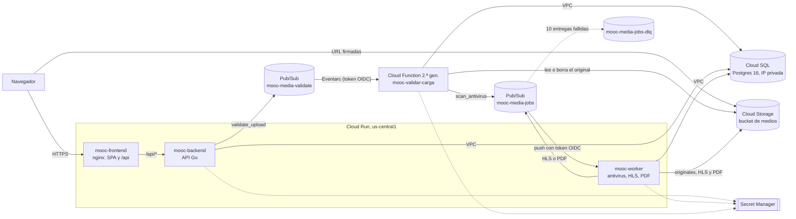

# Entrega 5 · Análisis serverless

Responsable: Daniela. Revisión de seguridad y verificación de punta a punta: Samara.

## 1. Punto de partida (Entrega 4)

La E4 ya corre en servicios administrados de GCP: tres servicios de Cloud Run (frontend, backend y worker), un Cloud Run Job de migraciones, Pub/Sub con tópico de fallidos, Cloud SQL con IP privada, un bucket privado y Secret Manager. Terraform crea todo desde `infra/terraform/`.

El worker hace tres trabajos por cada carga:

- `scan_antivirus`: descarga el original, calcula el SHA-256 real, detecta el MIME real, revisa la firma ZIP de las presentaciones y, si todo pasa, lo escanea con ClamAV.
- `transcode_hls`: convierte el video a HLS con ffmpeg.
- `convert_presentation_to_pdf`: convierte la presentación a PDF con LibreOffice.

## 2. Análisis por componente

| Componente | Hoy (E4) | Servicio serverless propuesto | Beneficio | Limitaciones |
|---|---|---|---|---|
| Frontend (SPA) | Cloud Run con nginx | Se queda en Cloud Run (alternativa: Firebase Hosting o un bucket con Cloud CDN) | Escala a cero y ya es serverless; nginx también reenvía `/api` al backend en el mismo dominio | Un bucket con CDN obliga a otro dominio o a un balanceador para `/api`, y cambia las cookies `SameSite` |
| Backend (API) | Cloud Run | Se queda en Cloud Run | Contenedor sin estado que escala de 0 a 3; las peticiones duran milisegundos | Pasarlo a funciones partiría la API en decenas de despliegues con el mismo código |
| Validación de la carga (parte de `scan_antivirus`) | Worker | **Cloud Function de 2.ª generación (`mooc-validar-carga`) disparada por Pub/Sub con Eventarc** | No usa binarios del sistema; dura segundos; escala por evento y no ocupa una instancia del worker de 4 GiB; un archivo inválido se descarta antes de gastar ClamAV, ffmpeg o LibreOffice | Necesita salida a la VPC para llegar a Cloud SQL; arranque en frío de unos segundos; un paso más en la cadena (más mensajes y más registros que seguir) |
| Antivirus (ClamAV) | Worker | Se queda en el worker (Cloud Run) | — | ClamAV necesita el demonio `clamd` y sus firmas (más de 1 GB en memoria); no cabe en el entorno de una función |
| Transcodificación HLS | Worker | Se queda en el worker | — | Necesita ffmpeg, CPU y disco temporal; un video largo puede pasar del tiempo útil de una función |
| Presentación a PDF | Worker | Se queda en el worker | — | Necesita LibreOffice instalado (cientos de MB) |
| Cola de trabajos | Pub/Sub push | Pub/Sub + Eventarc para la función | Mismo contrato de mensaje; Eventarc crea y administra la suscripción de la función | La suscripción que crea Eventarc no admite tópico de fallidos desde Terraform; el tope de intentos lo pone Postgres (ver §4) |
| Migraciones | Cloud Run Job, ejecutado a mano con `migrar.ps1` | Cloud Run Job ejecutado por Terraform (`run_execution_token`) | El despliegue queda en `terraform apply` sin pasos manuales; el backend nuevo sale después de migrar | Si Cloud SQL está apagada, `apply` falla al ejecutar el job |
| Base de datos | Cloud SQL (Postgres 16) | Se queda en Cloud SQL | — | No hay un Postgres que escale a cero en GCP; AlloyDB o Spanner cambian costo o modelo de datos |
| Archivos | Cloud Storage | Se queda | Ya es serverless | — |
| Secretos | Secret Manager | Se queda | Ya es serverless | — |

## 3. Tarea migrada y por qué

Se migra la **validación de la carga**: SHA-256 real, MIME real y firma ZIP de las presentaciones. Hasta la E4 eran los primeros pasos de `scan_antivirus`; en la E5 pasan a ser un tipo de trabajo propio, `validate_upload`, que ejecuta la función.

Por qué esta tarea y no las otras:

- Es la única de las tres que no depende de binarios del sistema (ClamAV, ffmpeg o LibreOffice). Se escribe en Go con la biblioteca estándar y cabe en el runtime administrado `go125`.
- Es corta y acotada: lee el archivo una vez y en flujo, sin cargarlo entero en memoria, con 512 MiB y menos de un minuto para los tamaños que admite la plataforma.
- Es el punto natural para filtrar: si el archivo no coincide con lo declarado, se borra y se detiene la cadena antes de ocupar una instancia del worker de 2 vCPU y 4 GiB.
- El resultado es el mismo que en la E4: los mismos campos en `media_assets` (checksum y MIME reales), el mismo borrado del original cuando falla y el mismo encadenamiento hacia el antivirus.

Se reconoce el límite: no se migra un trabajo entero del worker sino su primera etapa, separada como trabajo propio. Se eligió así porque mover el antivirus o la conversión a una función exigiría empaquetar binarios pesados y aumentaría el riesgo sin mejorar el resultado. El worker ya no hace la validación: `scan_antivirus` solo pasa ClamAV, y si le llega un `validate_upload` lo deja en `dead_letter` (PR #30).

## 4. Diseño

Flujo de una carga:

1. El navegador sube el archivo directo al bucket con URL firmadas.
2. Al confirmar la carga, el backend crea el `media_job` `validate_upload` en Postgres, publica `{"job_id": "..."}` en `mooc-media-validate` y responde sin esperar.
3. Eventarc entrega el mensaje a la función con un token OIDC de `sa-disparo-validar`.
4. La función toma el job (el mismo `UPDATE` atómico del worker), valida el original y:
   - si pasa: guarda checksum y MIME reales, cierra el job y encola `scan_antivirus` en `mooc-media-jobs` con la clave `<asset>:scan_antivirus`;
   - si no pasa: borra el original, deja el job en `dead_letter` y el recurso en `failed`, y confirma el mensaje.
5. Desde ahí todo sigue como en la E4: antivirus y luego HLS o PDF en el worker.

Interruptor de transición: el backend solo publica `validate_upload` cuando tiene la variable `PUBSUB_TOPIC_VALIDACION`, y Terraform la pone solo con `funcion_validar = true`. Con `false`, la plataforma funciona exactamente como en la E4. Así se puede desplegar el código nuevo antes que la función, y volver atrás cambiando una variable.

Reintentos sin duplicados:

- Si la función devuelve error, Eventarc reintenta con espera creciente.
- Cada intento toma el job con el `UPDATE` atómico; si otra instancia lo tiene o ya está `done`, confirma sin repetir nada.
- A los 3 intentos (`max_attempts`) el job pasa a `dead_letter` y la función confirma, así que el mensaje no se reintenta para siempre.
- El siguiente paso se encola con clave de idempotencia; un reintento después de encolar no crea un segundo `scan_antivirus`.

## 5. Identidades y permisos

- `sa-funcion-validar` (ejecuta la función):
  - `roles/storage.objectUser` solo sobre el bucket de medios (leer y borrar originales);
  - lectura del secreto `mooc-database-url`;
  - `roles/pubsub.publisher` solo sobre `mooc-media-jobs`;
  - registros y métricas.
- `sa-disparo-validar` (identidad del disparador de Eventarc):
  - `roles/run.invoker` solo sobre la función;
  - `roles/eventarc.eventReceiver`.
  - El agente de Pub/Sub puede firmar tokens como esta cuenta.
- `sa-build-funcion` (Cloud Build compila la función):
  - escribe registros;
  - lee solo el bucket de fuentes;
  - publica la imagen en el Artifact Registry `mooc-e4`.
- `sa-backend` gana `roles/pubsub.publisher` sobre `mooc-media-validate`.

La función no tiene URL pública (`ALLOW_INTERNAL_ONLY`) y sale a la VPC solo para rangos privados, como el backend y el worker.

## 6. Costos y límites

- La función escala de 0 a 3 instancias, con una petición por instancia y 2 conexiones a Postgres cada una. El total queda dentro de las 50 conexiones de Cloud SQL: backend 15, worker 9, función 6, migraciones 1.
- Se cobra por invocación y por tiempo de CPU; con el volumen del curso queda dentro del nivel gratuito.
- El worker sigue con 4 GiB porque ClamAV y ffmpeg los necesitan. La función sí evita gastar una instancia del worker en archivos que se iban a rechazar.
