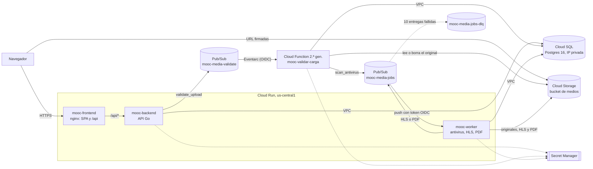

# Informe de arquitectura · Entrega 5: función serverless e infraestructura como código

Equipo: Daniela Solarte, Camila, Mateo y Samara · ISIS4426 · Noviembre de 2026

Este informe describe la arquitectura final de la plataforma MOOC. Sobre la base de la Entrega 4 (Cloud Run y Pub/Sub), la E5 lleva la validación de las cargas a una Cloud Function de segunda generación activada por Pub/Sub con Eventarc, y deja todo el despliegue y sus actualizaciones en Terraform. Los valores de configuración salen del código de `infra/terraform/` y de `functions/validar-carga/`. Los resultados salen de `docs/entrega5/evidencias/`.

Documentos relacionados:

- Análisis serverless (oportunidades, servicio propuesto, beneficio y límites): [`analisis-serverless.md`](analisis-serverless.md)
- Contrato de `validate_upload`, idempotencia y reintentos: [`contrato-validacion.md`](contrato-validacion.md)
- Guía de despliegue con `terraform init`, `plan` y `apply`: [`despliegue.md`](despliegue.md)
- Código de la función: [`../../functions/validar-carga/`](../../functions/validar-carga/)
- Arquitectura de la E4, que sigue vigente para lo que no cambió: [`../entrega4/informe-arquitectura.md`](../entrega4/informe-arquitectura.md)

## 1. Cambios frente a la Entrega 4

- **Validación de cargas en una Cloud Function.** El SHA-256 real, el MIME real y la firma ZIP de las presentaciones eran los primeros pasos de `scan_antivirus` en el worker. Ahora son un trabajo propio, `validate_upload`, que ejecuta la Cloud Function `mooc-validar-carga`. Esa función se activa por Eventarc con el topic nuevo `mooc-media-validate`. El worker ya no hace esta validación.
- **Interruptor de transición.** El backend solo empieza las cargas por `validate_upload` si tiene `PUBSUB_TOPIC_VALIDACION`. Terraform pone esa variable cuando crea la función, y el backend se despliega después de la función. Así nunca se publica en un topic sin consumidor.
- **Terraform gestiona más:**
  - la función, el zip de su código, el bucket de fuentes y su disparador;
  - tres cuentas de servicio nuevas;
  - la ejecución de las migraciones (`run_execution_token`);
  - el tráfico de Cloud Run, que queda fijo en la última revisión.
- **Migraciones automáticas.** En la E4 el job de migraciones se ejecutaba a mano con `migrar.ps1`. Ahora Terraform lo ejecuta cuando cambia su imagen y espera a que termine antes de actualizar el backend.
- **Reproducción de video (H4).** La API sirve el manifiesto HLS con cada segmento firmado (`GET /resources/:id/playback/manifest.m3u8`), y el bucket sigue privado.

## 2. Modelo de componentes

Responsabilidad de cada componente:

- **mooc-frontend (nginx):** sirve la aplicación web y reenvía `/api/*` al backend, en el mismo origen.
- **mooc-backend (API Go):**
  - expone la API y autentica con sesiones en Postgres;
  - entrega URL firmadas para subir y descargar;
  - sirve el manifiesto HLS firmado;
  - al confirmar una carga, crea y publica `validate_upload`.
- **mooc-validar-carga (Cloud Function, Go 1.25):**
  - lee el original del bucket en flujo y aplica las tres reglas de validación;
  - si pasa, guarda los valores reales y encola `scan_antivirus`;
  - si no pasa, borra el original y deja el trabajo en `dead_letter`.
- **mooc-worker (Go con ClamAV, ffmpeg y LibreOffice):** antivirus, conversión a HLS y conversión de presentaciones a PDF.
- **mooc-migraciones (Cloud Run Job):** aplica las migraciones. Terraform lo ejecuta cuando cambia su imagen.
- **Pub/Sub:**
  - `mooc-media-validate`, con la suscripción que crea Eventarc para la función;
  - `mooc-media-jobs`, con su suscripción push al worker, tópico de fallidos y suscripción de revisión.
- **Cloud SQL, Cloud Storage, Secret Manager y Artifact Registry:** igual que en la E4. Artifact Registry también guarda la imagen que Cloud Build compila para la función.

## 3. Modelo de despliegue

- **Proyecto y región:** un proyecto de GCP, `us-central1` para todo.
- **Red:**
  - Cloud SQL solo tiene IP privada.
  - Backend, worker, migraciones y la función salen a la VPC por salida directa, solo a rangos privados. La función la usa con `direct_vpc_network_interface`, así que no hace falta un conector de VPC (que tiene costo fijo).
  - Pub/Sub y Cloud Storage se usan por las API de Google.
- **Entrada:**
  - Frontend y backend: públicos con HTTPS.
  - Worker: solo acepta a `sa-pubsub-push`.
  - Función: sin URL pública (`ALLOW_INTERNAL_ONLY`); solo la invoca el disparador con `sa-disparo-validar`.
- **Imágenes:** `construir-imagenes.ps1` las publica con la etiqueta del commit. Terraform convierte la etiqueta en digest.
- **Código de la función:**
  - Terraform la empaqueta con `archive_file`.
  - El nombre del objeto en el bucket de fuentes lleva el hash del contenido, así que cambiar el código crea un objeto nuevo y actualiza la función.
  - Cloud Build la compila con el runtime `go125` y la cuenta `sa-build-funcion`.
- **Estado de Terraform:** en un bucket de GCS con versionado y bloqueo, fuera del repositorio.

## 4. Configuración de los servicios

Frontend, backend, worker y job de migraciones mantienen la configuración de la E4 ([sección 4 del informe de la E4](../entrega4/informe-arquitectura.md#4-configuración-de-los-servicios)). Lo nuevo:

**mooc-validar-carga** (variable `funcion_validar_config`)

- Instancias: mínimo 0, máximo 3
- CPU y memoria: 1 vCPU, 512 MiB (lee el archivo por partes, no lo carga entero)
- Concurrencia: 1 trabajo por instancia
- Tiempo máximo: 300 s
- Conexiones a Postgres: 2 por instancia (`DB_MAX_CONNS`)
- Variables: `S3_BUCKET`, `PUBSUB_PROJECT`, `PUBSUB_TOPIC`, `DB_MAX_CONNS`; secreto `DATABASE_URL` desde Secret Manager
- Cuenta de servicio: `sa-funcion-validar`

**Tráfico de Cloud Run.** Frontend, backend y worker declaran `traffic { type = LATEST, percent = 100 }`. En la E4, un ensayo de reversión con `gcloud` dejó el backend fijo en una revisión vieja, y como Terraform no declaraba el tráfico, `plan` no lo veía. Ahora un cambio manual aparece en `plan` y `apply` lo corrige (evidencias 07 a 09).

**Presupuesto de conexiones.** Cloud SQL admite 50 conexiones. El máximo posible es 31:

- 3 backends × 5 = 15
- 3 workers × 3 = 9
- 3 funciones × 2 = 6
- 1 del job de migraciones

## 5. Tareas asíncronas

**Recorrido de una carga**

1. El navegador sube el archivo directo al bucket con URL firmadas.
2. Al confirmar la carga, el backend crea el `media_job` `validate_upload` y publica `{"job_id": "..."}` en `mooc-media-validate`. Los atributos son `job_type` y `contract_version`, el mismo contrato de la E4.
3. Eventarc entrega el mensaje a la función como CloudEvent `messagePublished`, con un token OIDC de `sa-disparo-validar`.
4. La función toma el trabajo con el mismo `UPDATE` atómico del worker, filtrado a `validate_upload`. El bloqueo dura 60 s y se renueva cada 20 s.
5. La función valida el archivo:
   - si pasa: guarda el checksum y el MIME reales, crea y publica `scan_antivirus` con la clave `<asset>:scan_antivirus`, y después cierra el trabajo;
   - si no pasa: borra el original, deja el trabajo en `dead_letter` y el recurso en `failed`.
6. El worker sigue como en la E4: antivirus y después HLS o PDF.

**Reintentos sin efectos duplicados**

- Si la función devuelve error, Eventarc reintenta con espera creciente.
- Un mensaje repetido encuentra el trabajo `done` o `dead_letter` y se confirma sin hacer nada.
- De dos entregas simultáneas, solo una gana el `UPDATE`. La otra devuelve error y se reintenta más tarde.
- El paso siguiente se crea con `INSERT ... ON CONFLICT (idempotency_key) DO NOTHING`. Si la función falla después de encolar, el reintento no crea un segundo `scan_antivirus`.
- La suscripción que crea Eventarc no admite tópico de fallidos desde Terraform. El tope lo pone Postgres: a los 3 intentos (`max_attempts`) el trabajo pasa a `dead_letter` y la función confirma, igual que el worker.
- Si al worker le llega un `validate_upload` por error, lo deja en `dead_letter` al primer intento.

**Trazabilidad.** Cada invocación de la función deja un registro JSON con `severity`, `job_id`, `message_id`, `intento` y `estado_final`. Los valores posibles de `estado_final` son `done`, `reintento`, `ocupado`, `ya_terminado`, `dead_letter` y `descartado`. Un filtro por `job_id` en Cloud Logging sigue la carga desde el backend, pasando por la función, hasta el worker.

## 6. Infraestructura como código

**Qué gestiona Terraform** (`infra/terraform/`):

- Cloud Run: servicios, imagen por digest, CPU, memoria, concurrencia, escalado, tiempo máximo, variables, referencias a secretos y tráfico.
- Pub/Sub: los dos topics, la suscripción push al worker, el tópico de fallidos y su suscripción de revisión.
- La función: `archive_file`, bucket de fuentes, `google_cloudfunctions2_function` y su disparador de Eventarc.
- Identidades: nueve cuentas de servicio, una por responsabilidad, con permisos sobre recursos concretos.
- Secretos: solo los contenedores y quién los lee.
- Base de la plataforma: red, Cloud SQL, bucket de medios, Artifact Registry, APIs y el job de migraciones con su ejecución.

**Parámetros del entorno** (`terraform.tfvars`, que git ignora):

- `project_id`, `region`, `image_tag` e `image_tag_por_servicio`;
- `funcion_validar` y `funcion_validar_config`;
- `servicios_habilitados`, `topic_trabajos` y `topic_validacion`;
- `equipo` y `docentes`.

**Prerrequisitos fuera de Terraform** (documentados en la guía):

- El bucket del estado: Terraform no puede crear el bucket que guarda su propio estado.
- Los valores de los secretos: para que no pasen por el estado.
- Las imágenes de Cloud Run.
- Cloud SQL encendida mientras se aplica.

**Actualizaciones hechas solo con `plan` y `apply`:**

- **23 de noviembre, base de la E5 con la función apagada:** `19 added, 4 changed, 0 destroyed`. Terraform ejecutó la migración 000006. Después, `No changes` (evidencias 01 a 03).
- **24 de noviembre, imágenes nuevas** (incluye el arreglo del video): `0 added, 4 changed`. Después, `No changes` (evidencias 04 a 06).
- **25 de noviembre, tráfico:** `1 changed`; el backend pasó de `mooc-backend-00003` a la última revisión. Después, `No changes` (evidencias 07 a 09).
- **26 de noviembre, función encendida (`funcion_validar = true`):**
  - El `plan` mostró la función, el permiso de invocación del disparador, la variable `PUBSUB_TOPIC_VALIDACION` del backend y las imágenes nuevas (`3 to add, 2 to change`).
  - El primer `apply` pidió dos permisos, que se agregaron a `funcion.tf` (sección 8).
  - El `apply` final creó `mooc-validar-carga` y su disparador de Eventarc (`3 added, 2 changed, 1 destroyed`: la función del intento fallido se reemplazó).
  - Después, `No changes` (evidencias 10 a 12).

## 7. Persistencia y estado

- Ningún componente guarda estado propio. Postgres es la fuente de verdad de usuarios, sesiones, cursos, recursos y trabajos; los archivos viven en Cloud Storage. Cualquier instancia de la función, el backend o el worker puede atender cualquier mensaje.
- La función no guarda el archivo en disco ni en memoria: lo lee del bucket en flujo.
- Cloud SQL guarda una copia diaria y permite recuperar a un punto en el tiempo (7 copias y 3 días de registros de transacciones). Eso cubre el RPO de 15 minutos del enunciado general.
- Bucket de medios privado, con borrado recuperable de 7 días.
- Bucket de fuentes de la función privado; los zips viejos se borran a los 30 días.

## 8. Seguridad e identidades

Cuentas nuevas de la E5, con permisos sobre recursos concretos:

- `sa-funcion-validar`:
  - `storage.objectUser` solo sobre el bucket de medios (leer y borrar originales);
  - lectura de `mooc-database-url`;
  - publicar solo en `mooc-media-jobs`;
  - registros y métricas.
- `sa-disparo-validar`: solo invocar la función (`run.invoker` sobre su servicio), recibir eventos de Eventarc y usar las APIs del proyecto en su nombre (`serviceUsageConsumer`, que pidió el primer `apply`). El agente de Pub/Sub firma sus tokens.
- `sa-build-funcion`: escribir registros, leer el bucket de fuentes del proyecto y el que crea Cloud Functions (`gcf-v2-sources-<número>-<región>`, también pedido por el primer `apply`), y publicar la imagen en `mooc-e4`. Cloud Build no usa la cuenta por defecto de Compute Engine.
- `sa-backend` gana solo el permiso de publicar en `mooc-media-validate`.

La función usa Storage y Pub/Sub con el token de su propia cuenta, así que no necesita las llaves HMAC del bucket.

Secretos y estado:

- Los valores de los secretos solo están en Secret Manager.
- El estado de Terraform está en su bucket.
- `terraform.tfvars` está en `.gitignore`.
- Las evidencias no tienen correos ni claves: los que aparecían en evidencias de la E3 y la E5 se reemplazaron por `[correo oculto]`.

## 9. Operación y verificación

- **Despliegue:** `terraform init`, `plan` y `apply` ([guía](despliegue.md)). Al final, `plan` responde `No changes`.
- **Reversión:** se despliega la etiqueta anterior (`image_tag`) con `plan` y `apply`. No se apaga solo la función: el worker ya no valida, así que las cargas pasarían sin validar.
- **CI en cada PR:**
  - pruebas y cobertura del backend (SonarCloud);
  - frontend;
  - `terraform fmt` y `validate`;
  - para la función: `go mod verify` contra sum.golang.org, `go vet` y sus pruebas.
- **Pruebas de la función:**
  - carga válida;
  - reentrega;
  - entregas simultáneas;
  - rechazos;
  - reintentos hasta `dead_letter`;
  - falla al publicar sin duplicados;
  - consultas SQL contra un Postgres con las migraciones del repo.
- **Prueba de punta a punta en la nube:** subir un archivo, ver `estado_final=done` en los registros de la función y después el `scan_antivirus` en el worker. [pendiente: evidencia de Samara]

## 10. Capacidad, costo y limitaciones

- **Costo:**
  - La función escala a 0 y cobra por invocación y tiempo de CPU; con el volumen del curso queda dentro del nivel gratuito.
  - La salida directa a la VPC evita el costo fijo de un conector.
  - Cloud SQL sigue siendo el único costo fijo mientras está encendida.
- **Arranque en frío:** la primera validación después de un período sin uso tarda unos segundos más. El worker ya no recibe archivos inválidos, así que su arranque de 20 a 40 s (ClamAV) solo se paga por cargas válidas.
- **Sin tópico de fallidos para la función:** el tope de intentos está en Postgres. Un mensaje cuya base no responde nunca se reintenta hasta que vence la retención del mensaje (1 día).
- **Cloud SQL zonal:** sigue siendo punto único de falla, como en la E4.
- **Un paso más en la cadena:** más mensajes y más registros que seguir. El `job_id` común mantiene la trazabilidad.

## 11. Alternativas evaluadas

- **Migrar el antivirus, HLS o PDF a funciones:** cada una necesita un programa pesado (ClamAV y sus firmas de más de 1 GB, ffmpeg o LibreOffice). Empaquetarlos en una función aumentaba el riesgo sin mejorar el resultado. Se documentan como alternativas: Transcoder API para HLS y Cloud Run Jobs para HLS y PDF.
- **Un solo topic con filtro por `job_type`:** evitaba un topic, pero mezclaba dos consumidores con reglas de reintento distintas. Con un topic propio, la función y el worker escalan y fallan por separado.
- **Conector de Acceso a VPC sin servidor:** era la forma clásica de llegar a Cloud SQL, pero tiene costo fijo. La salida directa a la VPC ya estaba en uso en Cloud Run y el proveedor de Terraform la soporta para funciones.
- **Clientes oficiales de Storage y Pub/Sub en la función:** sus versiones actuales piden Go 1.26 y el runtime es `go125`. Con la API REST y el token de metadatos, como ya hacía el backend, la función tiene tres dependencias: `pgx`, `functions-framework-go` y `cloudevents`.
- **Importar los paquetes del backend en la función:** reutilizaba código, pero arrastraba MinIO, asynq y Redis. Se copiaron las cuatro consultas necesarias, con pruebas que las verifican contra Postgres.
- **Seguir ejecutando las migraciones a mano:** funcionaba, pero era un paso fuera de Terraform. Con `run_execution_token`, `apply` las ejecuta y el backend se actualiza después.

## 12. Cumplimiento de la arquitectura requerida (enunciado general, sección 4)

| Regla | Cómo se cumple |
|---|---|
| Monolito modular en Go con workers asíncronos independientes | Backend Go por módulos (`internal/`); worker en Cloud Run y la función para la validación |
| API y workers sin estado, escalan horizontalmente | Cloud Run y la función escalan de 0 a 3; el estado está en Postgres y en Cloud Storage |
| PostgreSQL como fuente de verdad; Redis para sesiones, caché, límites y cola | Postgres es la fuente de verdad. Desde la E4, sesiones y límites van en Postgres y la cola en Pub/Sub, como pidieron las entregas en la nube (informe de la E4, sección 11) |
| Binarios fuera de la base relacional | Originales, HLS y PDF en Cloud Storage |
| API publica trabajos; consumidores con idempotencia, reintentos con backoff y DLQ | Pub/Sub con backoff; idempotencia por `ClaimJob` y clave de idempotencia; tópico de fallidos para el worker y `dead_letter` en Postgres a los 3 intentos |
| REST JSON sobre HTTPS y URL prefirmadas para binarios | `/api/v1` por HTTPS; carga y descarga directa con URL firmadas, también para los segmentos HLS |
| Docker y Docker Compose, múltiples instancias | Todo corre en contenedores; `docker-compose.yml` para local y Cloud Run con hasta 3 instancias en la nube |
| Recuperación con RPO ≤ 15 min y RTO ≤ 4 h | Recuperación a un punto en el tiempo en Cloud SQL y despliegue completo con Terraform |
